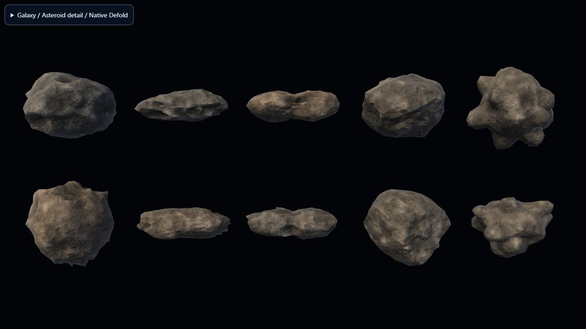

# Procedural asteroids

Each asteroid owns a seeded runtime rock mesh. Five resource-independent shape
families now share the field: weathered boulder, elongated shard, contact binary,
angular fractured chunk and consolidated rubble. Raised crater rims, fault scarps,
embedded boulders, cavity-darkened vertex colour and planar fresh faces provide
large and medium detail. A shared periodic surface field supplies triplanar fine
relief without UV seams. Geometry stays inside the original targeting sphere.
The same system ID and field index repeat after a jump or respawn; this visual
revision intentionally changes the old shapes, not their gameplay radii or seeds.
No global random state or server field data is changed.

When the existing server state marks a rock unavailable, the hub immediately
removes it from the targeting registry and sends `disintegrate` to its script.
Twenty closed fragments of that exact mesh separate over the first 0.32 seconds,
drift outward and tumble. They shrink and dissolve from 1.1 seconds, and the object
is deleted at 2 seconds. Repeated messages cannot restart the effect. Jumping
systems removes remaining debris immediately. Cached depleted rocks are skipped
on entry, avoiding a spurious explosion when revisiting a field.

Resource scans still animate `#model.tint`; `model` is now a mesh component on
asteroids only. The old sphere model and its generator remain in place because
`main/shot.go` uses them for tracers. Targeting radii, positions, mining rewards,
damage, respawn rules, network protocol and server modules are unchanged.

## Implementation and cost

- `main/asteroid_geometry.lua`: engine-independent generator, local integer PRNG,
  shared subdivision topology. Each rock stays within radius 0.5 before applying
  the existing `diameter_m` scale.
- `main/asteroid.script`: owns one unique buffer resource; detaches and releases
  it on deletion. Buffer bounds expand during breakup to prevent fragment culling.
- `assets/models/asteroids/rock.*`: local-space mesh and shaders using the existing
  `model` render predicate. Camera-relative key/fill lighting and a restrained rim keep surfaces readable.
  Opaque screen-door dissolution needs no new transparent render pass.
- 1,280 exterior triangles plus 480 fracture-wall triangles per rock; 5,280
  non-indexed vertices, 18 floats each (~371 KiB per mesh; ~18.1 MiB for 50).
  Generation and upload happen once per spawn. Breakup moves fragments in the
  vertex shader; each active effect updates just one uniform per frame. There are
  no extra fragment game objects or physics bodies.
- `[mesh] max_count = 256` provides room for the default 50-rock field, pending
  deletion during jumps and concurrent debris. Larger custom fields need a
  corresponding capacity/performance review.

The mesh/resource implementation follows the [Defold mesh manual](https://defold.com/manuals/mesh/)
and [resource API](https://defold.com/ref/resource/). Defold 1.13.1 is the version
pinned by this repository's Dockerfile.

## Reproduce validation

Install `lupa` into a disposable Python environment, then from the repo root:

```sh
python tests/test_asteroids.py -v
java -jar /path/to/bob.jar --platform wasm-web --architectures wasm-web resolve build
```

The tests execute the generator and scripts in Lua 5.1. They check 50 unique and
repeatable rocks, finite data, unit normals, bounds, non-degenerate triangles,
outward exterior winding, watertight correctly oriented fragments, independent
random state, depletion/scan/respawn/jump integration, duplicate events, exact
two-second lifetime and buffer release. Engine APIs in lifecycle tests are mocks;
these complement the actual compiled demo below.

## Standalone visual review (no login or live game server)

```sh
java -jar /path/to/bob.jar --platform wasm-web --architectures wasm-web --variant debug --settings tests/asteroid_preview/preview.ini --output build/asteroid-preview --bundle-output /path/outside/build/asteroid-preview --archive resolve build bundle
python tools/prepare_asteroid_preview.py /path/outside/build/asteroid-preview
python -m http.server 8037 --directory /path/outside/build/asteroid-preview
```

Open `http://localhost:8037/Asteroid%20Review/index.html`. Use the labelled buttons,
or click the canvas to use the keyboard controls.
This runs the actual game component, Lua generator and shaders. The population view shows ten rocks, two from each family; dense-field views exercise 50 and 100.

| Key | Action |
| --- | --- |
| Space | Break the displayed rocks with the real two-second lifecycle |
| R | Generate new seeds |
| A | Toggle an eight-second automatic spawn/breakup cycle |
| 1 | Inspect intact rocks |
| 2 | Inspect shader breakup at 0.65 seconds |
| 3 | Inspect shader dissolution at 1.5 seconds |

The numbered inspection modes hold the shader time for visual review; Space uses
the real timed effect. The preview overrides bootstrap/render settings only for
that build. It never connects to Nakama or sends weapon/mining requests.

## Validation scope

Automated geometry and mocked lifecycle checks and the complete Galaxy HTML5
client build passed. In the actual standalone Defold HTML5 runtime, intact,
fractured and dissolving stages were visually inspected; the timed effect cleared
the scene and repeated spawn/destruction cycles ran without reported engine
errors. Review screenshots are in `artifacts/asteroids/`. Live multiplayer mining and mobile-device frame
time/memory testing remain separate acceptance checks before deployment.

## Detail upgrade (October 2026)



[Original left / upgrade right](../artifacts/asteroids/detail/comparison.png),
[analysed mineral veins](../artifacts/asteroids/detail/analysed.png),
[fresh fracture faces](../artifacts/asteroids/detail/breakup.png).
These are offline native engine captures, not generated concept art or live
multiplayer screenshots. The preview preserves the original geometry/shader in
`tests/asteroid_preview/baseline/` from master `6d1f0a5` for honest comparisons;
these snapshots are not production dependencies.

### Resource concealment and lifecycle

Geometry, warm/grey variation and surface maps receive no resource information.
`main/asteroid_hub.script` adds only two visual writes: initialize the shader's
`analysis` flag from the existing per-player known-state table on spawn, and set it
after the existing scan completion callback. Scan timing, cyan tint animation,
cancellation, resource assignment, network and targeting behavior remain intact.
All four resource colours use the existing tint values. Analysed rocks reveal
sparse coloured veins with a subdued body tint; unanalysed rocks cannot reveal
those veins. This is a player-local display, not a server change.

The twenty existing closed fragment wedges still separate and disappear in exactly
two seconds. Fresh interior walls are brighter and carry short-lived neutral warm
edge highlights that cool within 0.7 seconds of each fragment's start. The opaque
screen-door dissolve is preserved. There are no new particle objects or transparent
dust passes: dense home fields already contain 100 rocks, so this pass spends the
budget on the rocks themselves. This deliberately omits the brief's optional dust.

### Measured budget and limits

| Cost | Original | Detail |
| --- | ---: | ---: |
| Vertices per rock | 5,280 | 5,280 |
| Triangles per rock | 1,760 | 1,760 |
| Mesh bytes per rock | 380,160 | 380,160 |
| Mesh memory / 50 rocks | 18.13 MiB | 18.13 MiB |
| Mesh memory / 100 rocks | 36.25 MiB | 36.25 MiB |
| Mesh draws per rock | 1 | 1 |
| Shared surface texture | none | 256 x 256, 192 KiB RGB8 / 256 KiB RGBA allowance |

The surface shader makes three texture samples and uses derivatives for relief
and subpixel-detail suppression. There is no extra per-rock texture, buffer stream,
per-frame CPU mesh work, mip chain, PBR pipeline, physics or render-pass change.
Geometry generation/upload remains once per spawn. No LOD is introduced because
vertex cost stays unchanged; a browser/device GPU profile is still needed before
claiming a frame-rate improvement or deciding whether distance LOD is worthwhile.

One shared source PNG is 73,850 bytes. The full-game archive stores 99,776 bytes
for that new texture; all replaced/new runtime resources together occupy 110,120
bytes before HTTP compression. That total is a replacement payload, not a net
download delta. See `artifacts/asteroids/detail/archive.json`.

Local Lua 5.1 CPU generation medians (three runs, excluding Defold upload/GPU):
50 rocks: 0.930 s original, 1.245 s detail (~34% more).
100 rocks: 1.865 s original, 3.347 s detail; detail samples varied 2.585–3.690 s
under concurrent desktop load. These are not browser timings. Extra crater,
boulder and normal work has a real spawn-time cost; both 50/100-rock previews are
included for acceptance testing. Native 100-rock creation visibly pauses the browser
(long enough to exceed a three-second UI inspection timeout), then finishes without
engine errors. Do not claim unchanged CPU/GPU performance from
the unchanged vertex counts.

### Reproduce and inspect

```sh
python tools/build_asteroid_surface.py
python tests/test_asteroids.py -v
python tools/check_asteroid_detail.py
```

The texture generator requires NumPy and Pillow; tests/measurement require
`lupa.lua51`. Regeneration is byte-identical in the checked environment. Eight
tests now cover the prior geometry/lifecycle invariants plus all archetypes,
unchanged buffer budgets, seeded resource/archetype distribution, texture rebake,
no veins during a scan, cancellation, scan completion, respawn and system return.
Distribution checks sample 5,200 rocks over 102 systems; they supplement the direct
architectural separation of visual generation from resource data.

Use the standalone build command above and the HTML preparation helper after every
bundle. Its controls add family selection, close-up, original/detail comparison,
analysis/resource toggles, 50/100-rock fields, seeded variants, drag/automatic
rotation and frozen breakup stages. Collapse the controls for an unobstructed
population view. The comparison always shows original left, upgrade right.
Review seeds stay below 16 million so Defold float32 properties preserve the
requested family exactly; production seed generation is unchanged.

This branch is based directly on master and does not require the separate sky or
station PR. No gameplay data, resource weights, field sizes, camera, renderer,
server modules or project limits are altered. Full game HTML5 and native preview
builds pass. Live multiplayer, mobile/low-end frame time and browser spawn-time
profiling remain separate acceptance checks.
