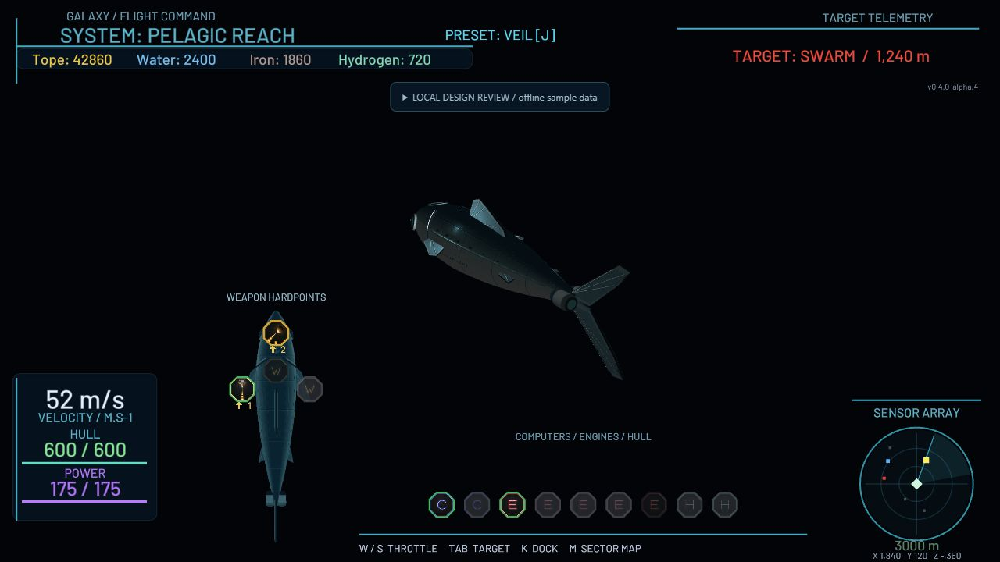

# Flight command UI

Native Defold GUI with a clear central flight area, live hull/power tracks, compact
spatial weapon hardpoints, service rows and restrained cyan instruments. Slots retain their original IDs,
icons, modifier-key indicators, click actions and cooldowns. Basic hulls still show
locked advanced slots. Radar orientation, sensor range and selected-target logic
are unchanged.

## Tuning

Edit `main/flight_hud.gui` in Defold for panel positions, colors and text scale.
`main/ui/flight_layout.lua` owns equipment spacing and gauge dimensions. The font
uses bundled Barlow Medium at 48 px with distance-field rendering. Its SIL Open
Font License and source attribution are included beside the font. Presentation does not change ship stats or network traffic.

Weapons sit over the current faction/hull silhouette using the original fitting
coordinates. Computers, engines and hull modules use compact rows of at most 10.
Empty and locked slots remain visible. Power uses electric violet, hull uses green,
and navigation instruments use cyan.
Hull/power fills clamp to [0,1]; zero or missing capacity gives an empty track.

## Verify

Run `luajit tests/flight_hud_harness.lua` (or Lua 5.1 with this project on package.path).
The harness covers ship-relative radar, selected-target restoration, telemetry,
all roster slot layouts, cooldown plumbing and click passthrough.

Compile the complete game using the project's normal Defold build. For the isolated
review, using Defold 1.13.1 Bob:

```
java -jar bob.jar --platform wasm-web --variant debug --archive --settings tests/flight_preview/preview.ini --bundle-output ../flight-review resolve build bundle
python tools/prepare_flight_preview.py "../flight-review/Flight UI Review/index.html"
python -m http.server 8490 --bind 127.0.0.1 --directory ../flight-review
```

Open `/Flight%20UI%20Review/index.html`. The collapsible review controls exercise
Patrol/Escort/Frigate slot layouts, low vitals, docking and clearing target state.
The Sardine is a fixed scene model; the class buttons test equipment layouts and the matching top-down hull image.
All telemetry is deliberately synthetic. The preview collection does not load
the login flow, network module or profile persistence and cannot spend live funds.
Its bootstrap override is supplied only to Bob; production game.project is unchanged.

The window requests 4x anti-aliasing; support depends on the graphics backend.
Text sizes are tuned for a 720p or larger landscape play area.

This PR changes the flight UI and window anti-aliasing. Station UI and ship graphics are independent.
Live multiplayer and low-end GPU performance require a separate integration pass.

## Verified on 2026-10-12

Full-game and isolated HTML5 builds passed with Defold 1.13.1. Native preview
interaction was checked in the browser at 1280 x 720.
All flight HUD harness assertions passed, including radar selection, all roster
equipment layouts, clamped gauges, equipment clicks and world passthrough.
Low vitals and the Frigate equipment layout were checked visually.

The current upstream Escort definitions have empty slot-position tables. Their
silhouettes render without invented hardpoints; this UI deliberately preserves
that game data. Patrol and Frigate weapon maps use their existing configured slots.
The final spatial layout was checked at 1280 x 720, including Frigate hardpoints,
Escort silhouette, low vitals and weapon cooldowns. Power is electric violet.


