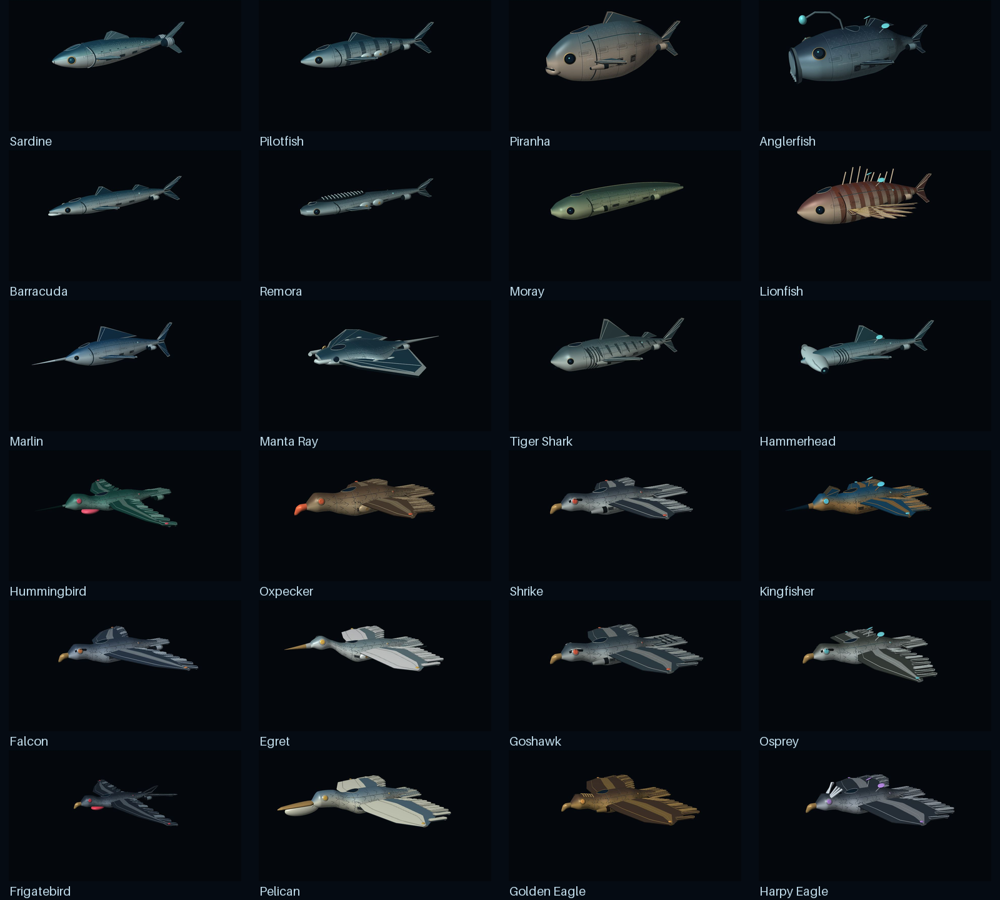

# Detailed fleet hulls

24 original fish/bird identities with smoother curved surfaces, modeled bilateral
service vents, fasteners and navigation ports. The 2048px albedo keeps the approved
UV atlas and adds finer engraving, service hatches and hull labels. A restrained
metal-highlight shader retains the existing `tex0`, `tint`, `light` and `model`
contracts. This is a simple per-pixel metal finish, not a full PBR/normal-map pipeline.

Sardine's twin engine radius is 1.65 times the approved version; housing length is
1.2925 times, with cooling collars and open nozzle lips. Its rounded nose, single
gill cover and equal forked tail remain. No speed, collision, slot, balance or
network changes are made. Moray remains straight and bilaterally symmetrical.
Patrol / Escort / Frigate maximum dimensions remain 1:4:16 within each faction/role.

## Integration and preservation

New files live in assets/models/hd/<ship>/ and assets/materials/ship_finish/.
The approved GLBs and textures are preserved byte for byte at their old paths.
Existing base .model descriptors select the detailed mesh/material/texture, so
current player, remote-player and hangar factories use the upgrade automatically.
72 Aurora, Royal Amethyst and Solar Regatta descriptors use the same detailed hull;
their original textures and the runtime recolor-swap contract are preserved.

Surface themes and sculpted variants have their own authored meshes and retain
those assets. They are not regenerated or silently replaced by this PR. Existing
livery/shop thumbnails likewise retain their approved art. This PR upgrades the
24 base hulls and compatible shared-mesh recolors, not all separately sculpted skins.

To opt a ship out, restore its .model descriptor's mesh, texture and material from
the original values in artifacts/ship-detail/manifest.json. Keep the old files:
they are the fallback. No destructive asset migration is required.

## Reproduce and validate

Python 3, Pillow >=10.1 and NumPy:

```
python tools/build_hd_fleet.py --integrate
python tools/check_hd_fleet.py
```

Without --integrate the builder only writes detailed assets and their manifest.
--ship sardine rebuilds a single specimen and its separate manifest; rebuild the
whole roster after changing generator code to refresh the canonical manifest.
The legacy generator defaults remain unchanged.

The independent checker reads exported binary data and checks finite positions,
unit normals, nondegenerate triangles, winding, UV bounds, uint16 vertex limits,
embedded/external texture agreement, original hashes, model/recolor descriptors,
Moray symmetry and faction/role size ratios.

## Native comparison preview

```
java -jar bob.jar --platform wasm-web --variant debug --archive --settings tests/ship_detail_preview/preview.ini --bundle-output ../ship-review resolve build bundle
python tools/prepare_ship_detail_preview.py "../ship-review/Ship Detail Review/index.html"
python -m http.server 8490 --bind 127.0.0.1 --directory ../ship-review
```

Open /Ship%20Detail%20Review/index.html. Pick a ship and compare Original / Detailed /
Solar Regatta. Front, Rear and Rotate controls inspect silhouettes and engine ends.
Only this review scene normalizes ships to the same display size. The production
game retains their real dimensions. No account or network modules are loaded.
Use the normal project build without --settings for production compilation.

## Rendering cost

One mesh primitive and one material remain per hull. Textures are 2048 square
instead of 1024; an uncompressed RGB base texture is approximately 12 MiB instead
of 3 MiB before any backend conversion or mipmaps. No automatic LOD is added.
Dense multiplayer scenes and low-end/mobile GPUs need profiling before release;
the retained originals provide a practical lower-detail fallback. No performance
claim is inferred from geometry or compilation checks alone.

| Ship | Original triangles | Detailed triangles | Vertices |
| --- | ---: | ---: | ---: |
| Sardine | 14,252 | 43,452 | 28,080 |
| Pilotfish | 9,744 | 31,872 | 19,866 |
| Piranha | 9,444 | 29,860 | 18,837 |
| Anglerfish | 9,208 | 29,912 | 18,993 |
| Barracuda | 9,584 | 30,000 | 18,989 |
| Remora | 11,076 | 35,572 | 22,035 |
| Moray | 10,164 | 31,012 | 19,346 |
| Lionfish | 9,692 | 28,620 | 19,098 |
| Marlin | 9,076 | 28,004 | 17,854 |
| Manta Ray | 9,156 | 33,092 | 20,009 |
| Tiger Shark | 10,192 | 29,120 | 18,402 |
| Hammerhead | 11,280 | 34,816 | 21,155 |
| Hummingbird | 13,192 | 33,232 | 24,689 |
| Oxpecker | 14,540 | 37,668 | 27,623 |
| Shrike | 13,620 | 33,548 | 25,339 |
| Kingfisher | 13,184 | 31,152 | 24,336 |
| Falcon | 13,148 | 33,076 | 24,571 |
| Egret | 14,036 | 35,204 | 26,364 |
| Goshawk | 13,840 | 33,768 | 25,539 |
| Osprey | 13,524 | 33,452 | 25,235 |
| Frigatebird | 13,204 | 35,204 | 25,198 |
| Pelican | 15,628 | 41,884 | 29,890 |
| Golden Eagle | 13,752 | 33,680 | 25,459 |
| Harpy Eagle | 13,604 | 33,532 | 25,347 |

## Visual verification

All 24 detailed hulls were inspected in the native Defold HTML5 comparison scene,
with each capture waiting for the selected model to render. The complete game
and isolated preview compiled successfully with Defold 1.13.1 on 2026-10-12.
Sardine's rear engine openings and its Solar Regatta recolor were also inspected.
This covers offline rendering, not live multiplayer or a GPU performance budget.


