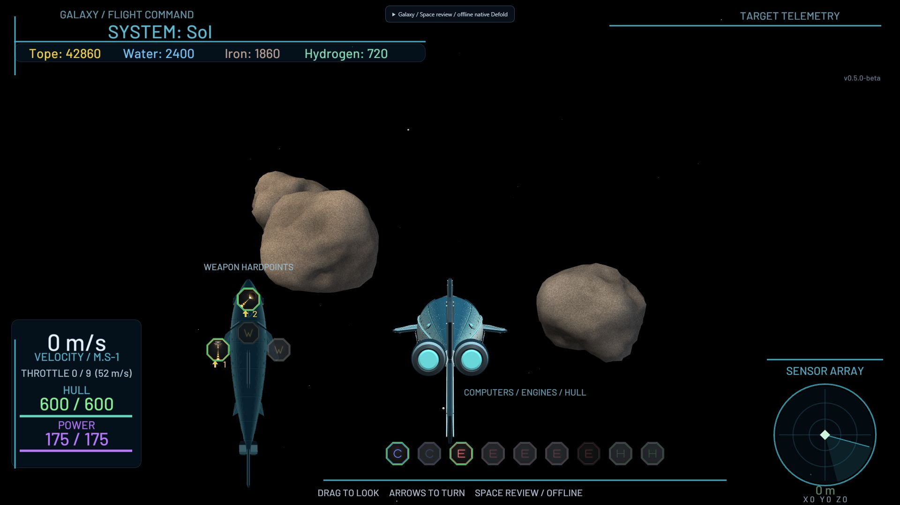
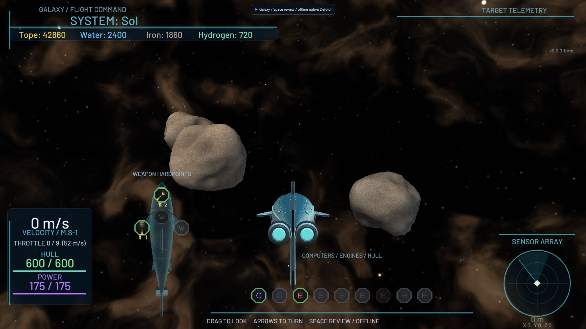

# Textured space

Galaxy's flight background has layered gas, dark dust lanes, 17,000 seeded stars,
and a single stellar anchor per system. Sol has a warm golden wake; Polaris has a
cold indigo rift. Ordinary systems use five visual families, including sparse dark
reaches. System IDs determine orientation, field mixing, coverage and star gain.
The BSGO reference supplied by the user informed the visible smoky texture and
restrained brightness; no imagery or code was copied from it.

## Approach

One shared 1024-pixel, six-face cubemap stores two scalar nebula fields and stars.
A deterministic Python bake evaluates domain-warped 3D noise on unit directions,
so all faces share a continuous spherical field without equirectangular poles.
The shader combines two rotated samples and a per-system grade. It has no
raymarching, time noise, twinkling or fullscreen postprocessing. Final spatial
dither and filtered scalar fields soften dark gradients. Eight very faint nearby
wisps occupy one additional mesh, with static world positions and travel-driven
recycling. The existing 60 dust motes are unchanged.

The sky shader discards camera translation, uses the active camera's rotation and
projection, and sets clip depth to infinity. `render/space.lua` draws its dedicated
predicate before world models, without depth writes, depth test, blending or
frustum culling. The world camera/state is restored by the existing renderer.
Wisps draw after opaque models with depth testing and alpha blending; they fade
before reaching the eye. Neither tag is `model`, so docked ship-preview overlays
cannot redraw the sky or wisps.

## Integration boundaries

`main/space.script` only observes `session.flying` and `get_current_system()`;
it sends a small render message on changes. Launch, dock, death/logout and system
changes do not require changes to the flight or networking implementation.
`main/space_wisps.script` observes the same state and player transform, uses its
own PRNG and owns/releases one runtime vertex buffer. No changes to ship assets,
HUD, asteroids, stations, dust, gameplay positions, targeting, economy or server
modules are needed. Two new instances are registered in `main/main.collection`.

`main.space_profiles.get(system_id)` exposes `light_direction` (normalized
world-space direction **toward** the stellar anchor) and `light_color`. This is a
future presentation hook; this PR deliberately keeps existing ship/station/rock
light contracts. Those currently mix a positional light with fixed key/fill
directions and need a separate compatible lighting change before consuming it.

## Texture compatibility

The sky-specific texture profile enables mipmaps and retains uncompressed RGB
GPU storage. Its catch-all profile exactly preserves the prior built-in defaults
for other game art. The two low-intensity scalar fields use six-bit values in
8-bit channels; stars retain eight bits. This permits lossless bundle/HTTP
compression without reducing spatial resolution.

Do not switch this cubemap to BasisU on Defold 1.13.1: native browser QA exposed
incorrect face adjacency in compressed output. Keep the portable profile unless
a future engine upgrade is separately verified. Merely passing a build is not
sufficient to validate a cubemap.

## Reproduction

Authoring dependencies: Python, NumPy, Pillow; validation also uses `lupa`'s Lua
5.1 runtime. No Python packages are needed at game runtime.

```text
python tools/build_space.py
python tools/check_space.py --rebuild
java -jar <bob.jar> --platform wasm-web --variant debug --settings tests/space_preview/preview.ini --archive --bundle-output <external-review-folder> resolve build bundle
python tools/prepare_space_preview.py "<external-review-folder>/Space Review/index.html"
```

Serve that external review directory over localhost. For the full game, omit
`--settings` and use a separate external bundle folder. Keep bundle outputs outside
the reserved project `build` directory. The review helper fingerprints archive
URLs after each build to avoid stale resources.

The offline review uses the actual HD Sardine, existing procedural asteroids,
production HUD, production render script and the actual Patrol chase-camera
distance/height and camera resource. It does not log in or connect to a game
server. Controls include all 58 systems, old/new, travel/stop, auto rotation,
mouse-drag/arrow look, six view directions, camera reset and the ship-preview
overlay. The dropdown/status acknowledges the system actually selected by Lua.
The old/new toggle removes both new effects while retaining the original dust.

## Costs and verification

See `artifacts/space/validation.json` for exact bake metrics and
`artifacts/space/review.json` for measured packaged sizes and native QA.

- Sky: 12 triangles, one mesh draw, two cubemap samples per fragment.
- Wisps: 16 triangles, one mesh draw, 1,152 bytes of vertex attributes; no texture.
- Added component use: two meshes, zero model components, zero particle systems.
- Cubemap: 24 MiB for RGB8 including mips; conservatively budget 32 MiB if a
  backend expands RGB to RGBA. It is shared by every system, never 58 copies.
- The catalogue has 17,000 baked stars, not 17,000 game objects.
- Existing 60 model-based dust motes and their draw cost are unchanged.

Validation covers repeatability, all 12 spherical edge pairs, all 58 profiles,
PRNG isolation, flight/session transitions, active-camera selection, render pass
state, stationary/travel/teleport wisp behaviour and buffer release. Native
screenshots belong under `artifacts/space/`; they are game renders, not concept
paintovers. Full-game compilation and offline visual QA do not establish live
multiplayer correctness or mobile/low-end GPU performance. No performance claim is
made for those devices.

## Native comparisons

Identical Patrol flight framing, existing assets and production HUD:

| Original | Sol |
| --- | --- |
|  |  |

[Polaris](../artifacts/space/polaris.png), [Wolf 359](../artifacts/space/wolf_359.png),
[Antares](../artifacts/space/antares.png), [Deneb](../artifacts/space/deneb.png).

The full-game archive stores approximately 13.36 MiB of new resource payloads.
The compiled sky alone is 24.00 MiB raw and 11.34 MiB if gzip-compressed separately.
This exceeds the provisional 12 MiB archive target by about 1.36 MiB; the chosen
tradeoff keeps 1024-pixel faces, mipmaps and the engine-compatible face layout.
Actual network bytes depend on the hosting server's HTTP compression. Source PNGs
are 3.87 MiB. Do not describe PNG size or the gzip estimate as the measured live
download. Native source checks and builds passed; Bob reported only cleanup
warnings for temporary build folders after successful bundling.
