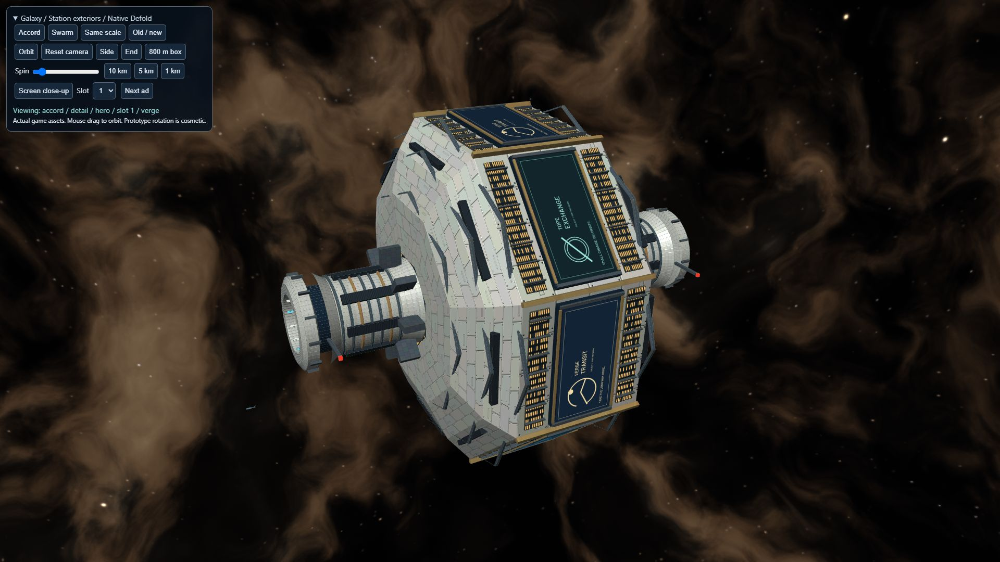
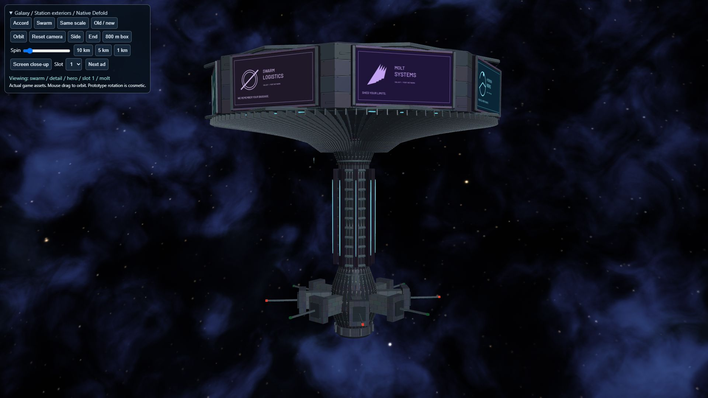

# Station exteriors

Two deterministic, game-ready station assemblies replace the outpost placeholders.
Accord is a crewed ivory/navy gravity drum around a stationary docking spindle;
Swarm is a graphite machine crown with 112 curved cooling vanes and a fixed stem.
These are lightweight hard-surface assets for the current renderer, not the
photorealistic concept paintings. Panel relief, specular highlights, windows and
navigation lights use a small custom shader; there is no PBR, shadow or normal-map
pipeline dependency.

## Native views

| Accord | Swarm |
| --- | --- |
|  |  |

[Same scale](../artifacts/stations/same-scale.png),
[screen close-up](../artifacts/stations/ad-closeup.png),
[measured bounds](../artifacts/stations/bounds.png),
[original placeholders](../artifacts/stations/originals.png).

These captures come from an offline native Defold inspection scene using the
production station meshes, materials and animation. The optional backdrop uses
the separate space PR. It is not a multiplayer or live-account gameplay capture.

## Geometry and cost

One unit is one metre; station axes remain along Z and the world remains Y-up.
The original root positions and local offsets are preserved. Only the drum/cap
and its eight screens rotate; docks, supports and stem remain fixed. Periods are
110 seconds (Accord) and 120 seconds (Swarm), tunable in `main/station_visual.lua`.

| Station | Triangles, including ads | Full swept dimensions | Model draw upper bound |
| --- | ---: | --- | ---: |
| Accord | 12,352 | 628.04 x 628.04 x 756 m | 10 |
| Swarm | 17,600 | 732 x 732 x 712 m | 10 |

The independent GLB checker includes billboard corners and the complete analytic
rotation envelope, not just one angle. Both fit an 800 m cube. Both meshes together
are 29,952 triangles, so this pass uses a single mesh level; low-end GPU timing is
still required before deciding whether a distance LOD is useful.

Textures are two 2048-square hull atlases and eight shared 1024x512 ad images.
Full mip chains use approximately 48 MiB RGB8, with a conservative 64 MiB allowance
if a driver expands storage to RGBA8. Anisotropic filtering reduces oblique shimmer.
Generated source assets total about 2.23 MiB. The full station-only game archive
contains 1,838,261 bytes (1.75 MiB) of new unique resource payloads, before HTTP
compression. This excludes small integration/index changes and removed placeholder
resources; it is not a measured net download delta. See `artifacts/stations/costs.json`
and `validation.json`. Draw counts are component bounds, not a GPU timing result.

## Sponsor artwork

Each faction has eight flat 200x100 m screens. Supply an opaque 1024x512 RGB PNG,
2:1 aspect, without baked perspective. Keep essential text/logos 64 pixels from
the left/right and 32 pixels from the top/bottom (6.25% per edge).
[Download the guide](station-ad-template.png); remove its guide marks for delivery.
Screens use unlit RGB sampling: no hull tint, fog, exposure, bloom or lighting
multiplier touches the artwork. Fine print is only expected to read close up.

Eight original fictional ads are included. Assignments live separately in
`main/data/station_ads.lua`. For a bundled swap:

```lua
local ads = require "main.station_ads"
local ok, reason = ads.set_ad("accord_outpost", 1, "verge")
```

Station keys are `accord_outpost` and `swarm_outpost`, slots are 1..8. A Defold
texture resource hash can replace the final string argument. A future loader can
fetch validated image bytes, decode them, create a Defold texture resource and
pass its handle through this API. The caller owns and retains that resource while
bound, replaces it before releasing it, and handles downloads/failures. No network
fetching, account data or analytics is added here. Future impression measurement
belongs after actual projection, occlusion and dwell checks; registering or
rotating a slot is not an impression.

## Gameplay and merge notes

Dock range (1000 m), launch distance (1200 m), docking time, root IDs, positions,
faction availability, targeting and networking are unchanged. The visual observer
mirrors launch/dock, system availability and respawn state for all ten components,
so child screens cannot remain floating after a station is hidden. Rotation is
cosmetic and pauses while hidden.

The existing 150 m targeting/click marker remains smaller than the new hull.
This is a gameplay decision for Shaky, not silently expanded by this art PR.
No new physical collision is added. The complete structures remain inside the
unchanged 1000 m docking sphere, measured from the preserved root.

This branch is independently based on master and needs no space PR code. When
combining with space PR #22, retain the `game.project` graphics setting
`/assets/materials/stations/stations.texture_profiles`: it also contains the
space cubemap rule. That configuration line may require merge resolution in either
order. Other assets retain the previous built-in default profile. The production
station light remains the current game's fixed position. `station_light` sent to
`station_visuals#script` with a `position` vector4 is a future integration hook.

## Rebuild and review

Python with Pillow is required; the builder uses the repository's Barlow font.

```text
python tools/build_stations.py
python tools/setup_station_exteriors.py --integrate
python tools/check_stations.py --rebuild
lua5.1 tests/station_exteriors_harness.lua
java -jar bob.jar --platform wasm-web --variant debug resolve
java -jar bob.jar --platform wasm-web --variant debug --settings tests/station_exterior_preview/preview.ini --archive --bundle-output <external-output> build bundle
python tools/prepare_station_exterior_preview.py "<external-output>/Station Exterior Review/index.html"
```

Serve that bundle directory locally. Controls include faction, same scale, old/new,
orbit/drag, orthographic side/end, bounding box, viewing distance, spin speed,
screen close-up, slot selection and ad cycling. A small existing ship gives scale.
Keep bundle output outside the checkout. Legacy outpost builder entry points now
call the canonical generator; old GLBs/palette textures remain for comparison.

For an optional combined sky review, point `tools/prepare_station_space_review.py
--space-root <space-checkout>` at the separate sky branch and build using
`tests/station_exterior_preview/combined/preview.ini`. Generated copies are ignored
and never shipped as duplicate production assets.

Validation: byte-identical regeneration, GLB normals/winding/UVs, swept bounds,
rotation/fixed-dock/visibility/ad API Lua harness, existing starfield/HUD/throttle/
speed harnesses, standalone/combined preview builds and full-game HTML5 build.
Native browser inspection found no runtime errors or warnings. Live multiplayer,
mobile/low-end hardware performance and live account persistence were not tested.
