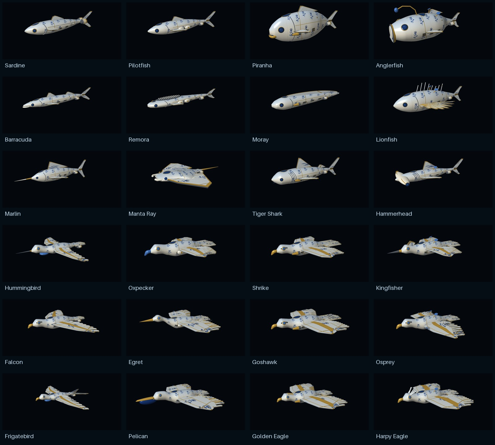
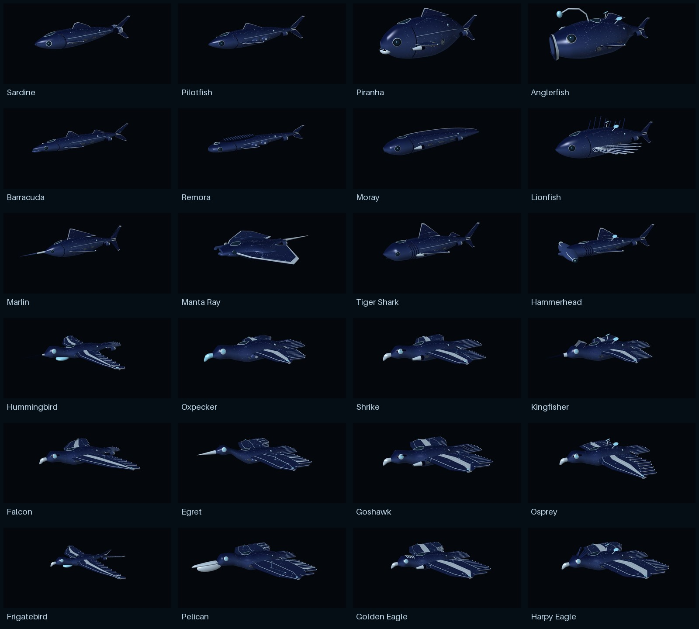
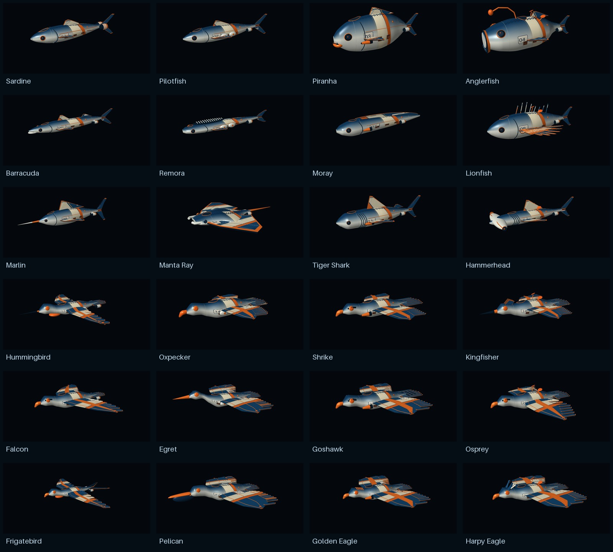

# Detailed surface themes

Porcelain Dynasty, Starlight and Grand Prix now use the detailed fish and bird hulls across all 24 ships (72 variants). The geometry includes smoother silhouettes, modeled vents, fasteners and running lights, plus the enlarged Sardine engines. Ship dimensions and the symmetric Moray remain unchanged.

## The three finishes

- **Porcelain Dynasty:** fresh 2048px cobalt botanical ornament, fine leaf veins, gold borders and repair seams, with an ivory glaze highlight.
- **Starlight:** fresh 2048px star fields, constellation lines and silver markings, with a restrained luminous finish.
- **Grand Prix:** fresh 2048px racing stripes, checkers and individual 01-24 race numbers, with a painted clearcoat highlight.

These are native game materials, using the existing model render contract. They do not add a PBR renderer, normal maps or gameplay lighting dependencies.

## Integration and preservation

Only the 72 selected `assets/skins/<ship>/<theme>/ship.model` descriptors are redirected. Their new meshes and textures live in `assets/skins/hd/`; materials live in `assets/materials/theme_finish/`. Existing factories, resource IDs, prices, ownership, thumbnails, networking and gameplay stats are unchanged.

All 288 original skin GLBs and PNGs are preserved byte for byte, including these three collections. The original catalog manifests continue to describe those retained assets. `artifacts/theme-detail/manifest.json` describes the upgraded assets and records both original and upgraded hashes. Restoring the original descriptor paths restores the original appearance.

The PR is self-contained and does not require the flight HUD PR. Its checked-in geometry snapshots match the detailed fleet from PR #20; they allow deterministic rebuilding without depending on a separate branch or changing the shared fleet generator. That fleet PR has since been merged upstream. Other collections are not upgraded here.

## Rebuild and validate

Python requires NumPy and Pillow, as used by the existing asset pipeline.

```sh
python tools/build_hd_surface_themes.py --integrate
python tools/check_hd_surface_themes.py --rebuild
```

The builder supports `--ship sardine`, `--theme porcelain_dynasty` and `--output-root <directory>` for isolated experiments. If the legacy theme library is regenerated, rerun the detailed builder with `--integrate` afterward to restore the upgraded descriptor references.

The lossless authoring snapshots are in `tools/themes/detail_sources/`; their manifest records source commit and hashes. To intentionally import a newer detailed fleet, use `python tools/import_surface_detail_sources.py --fleet-root <detailed-fleet-checkout>`, rebuild and validate. Normal rebuilds use the checked-in snapshots and need no second checkout.

Validation covers all 72 upgraded GLBs: finite geometry, unit normals, valid indices/winding, source geometry equality, UVs, 2048px embedded/external texture agreement, exact extents, Moray symmetry, materials and existing factory integration. It also checks every original skin mesh/texture against its original catalog hash and byte-compares a complete deterministic rebuild.

## Native visual review

Build a separate offline Defold HTML5 preview (the production bootstrap is unchanged):

```sh
java -jar bob.jar resolve
java -jar bob.jar --platform wasm-web --variant debug --archive --settings tests/theme_detail_preview/preview.ini --bundle-output <external-output> build bundle
python tools/prepare_surface_theme_preview.py "<external-output>/Surface Theme Review/index.html"
```

Serve that output using a local HTTP server. The preview loads one model at a time and offers all 24 ships, three themes, original/upgraded comparison, front/rear views and rotation. Review sizes are normalized for inspection; gameplay dimensions are not changed.

All 72 upgraded variants were rendered in the native Defold HTML5 preview and inspected in the contact sheets below. Original/upgraded Sardine comparison and rear engine finishes were also checked. Both the isolated preview and the complete game HTML5 build passed. The validation report is `artifacts/theme-detail/validation.json`.





## Cost and remaining QA

New runtime asset sources total about 75 MiB; authoring snapshots add about 7 MiB. A 2048px texture has four times the texels of the original 1024px texture. Each model retains a single primitive/material and 16-bit indices. There are no new LODs. Dense multiplayer scenes, mobile memory/performance and live account purchases have not been tested. Existing shop thumbnails are retained.
